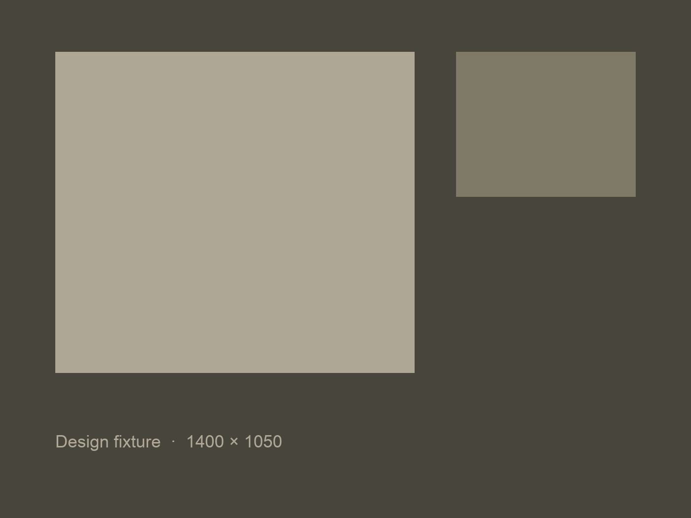

Case study placeholder. This fixture exercises every element the case study layout styles: headings, paragraphs, lists, quotes, code, tables, images and links.

## Section heading placeholder

Paragraph placeholder with a [link](https://example.com), **strong text**, _emphasis_ and `inline code`. The reading column keeps lines near 68 characters so long case studies stay comfortable to read.

- Unordered list item placeholder
- A second item that is long enough to wrap onto another line and test the hanging indent of the list
- Third item

### Subheading placeholder

1. Ordered list item placeholder
2. Second ordered item
3. Third ordered item

> Pull quote placeholder. A short sentence set larger, in the display face.

```ts
// Code block placeholder
export function sample(value: number): number {
  return value * 2;
}
```

| Column  | Placeholder | Notes                                                       |
| ------- | ----------- | ----------------------------------------------------------- |
| Row one | Value       | Table cells wrap when the content is long enough to need it |
| Row two | Value       | Short note                                                  |



A closing paragraph placeholder after the image.
